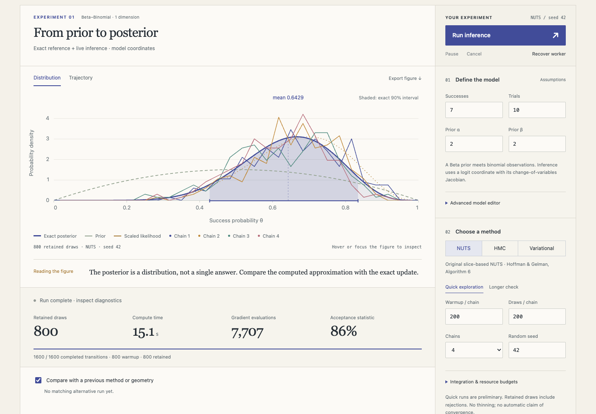
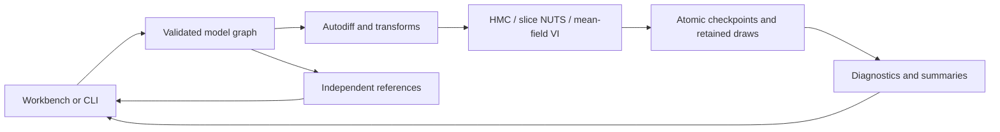

# Posterior

An inspectable Python Bayesian inference engine with a browser workbench for understanding what an algorithm learned—and what it missed.

[](pyproject.toml)
[](LICENSE)
[](https://dhanushkrishna4.github.io/Posterior/)

[Live demo](https://dhanushkrishna4.github.io/Posterior/) · [Documentation](#documentation) · [Validation](#validation-and-results) · [License](#license)



## Highlights

- **Three inference methods:** Hamiltonian Monte Carlo, original slice-based NUTS, and reparameterized mean-field Gaussian variational inference.
- **An inspectable Python core:** float64 NumPy/SciPy computation, reverse-mode autodiff, constrained parameters, Jacobians, windowed adaptation, diagnostics, and checkpointing.
- **Five experiments:** Beta–Binomial updating, conjugate regression, correlated Gaussian geometry, centered/noncentered funnels, and a separated mixture with unequal weights.
- **Interactive evidence:** trace/rank/objective plots, transition replay, independent references, JSON model editing, regression CSV import, saved experiments, and JSON/CSV/PNG exports.
- **Local execution:** the same package runs natively or inside a persistent Pyodide worker; no inference server, credentials, or GPU. Imported data stays on the device.

## How it works

A validated model graph compiles into a log joint and gradient in unconstrained coordinates. Parameter transforms include their Jacobians once. Inference runs in Python; JavaScript manages controls and plots.



NUTS implements **Hoffman–Gelman Algorithm 6**, with slice sampling, recursive trees, endpoint U-turn tests, and the final doubling subtree's adaptation statistic. It uses neither multinomial selection nor momentum-sum stopping. Recursive and top-level candidate probabilities differ deliberately; see [the sampler specification](docs/samplers.md).

Diagonal preconditioning is the coordinate change `z = S x`; turning tests operate in working coordinates. Each chain owns its adaptation and random state. Warmup is excluded from summaries; depth-limit events remain distinct from divergences.

Only completed transitions commit. Pause/cancel act at transition boundaries; worker recovery restores the last received checkpoint. Generation IDs reject stale responses. Retained draws are never thinned; plot downsampling does not alter diagnostics or exports. [Browser contracts](docs/browser.md) explain recovery, bounded messages, and plot semantics.

## Run locally

Use Python 3.12 and Node 22 to match CI. From the repository root:

```sh
python3.12 -m venv .venv
.venv/bin/python -m pip install -r requirements-dev.txt
.venv/bin/python -m pip install --no-deps -e .
npm ci
npm run vendor
npm run build
npm run preview
```

Open **http://127.0.0.1:4173/Posterior/** over HTTP, not `file://`. Vendoring downloads pinned runtime assets during preparation; the built site serves them itself. For development, use `npm run dev`; after Python edits, run `npm run package:engine`. Production builds repackage automatically.

Run the same engine natively:

```sh
.venv/bin/python -m posterior_lab.cli --preset beta --algorithm nuts \
  --warmup 200 --draws 200 --chains 4 --output experiment.json --csv draws.csv
```

Use `--model examples/beta.json` for a custom graph, `--algorithm vi --iterations 1000` for VI, or `--resume experiment.json` for a compatible checkpoint. Incomplete runs exit with status 2.

## Validation and results

These are **saved results**, not fresh runs from this documentation update. Reports retain settings, seeds, environments, raw draws, and failed cases.

| Evidence | Recorded result |
| --- | --- |
| [Deployment record](reports/deployment.json) | 178 Python tests and 18 browser checks passed before publication |
| [Hosted browser checks](reports/hosted/report.json) | 18/18 checks against the deployed workbench |
| [Fixed-kernel validation](reports/sampler-validation.json) | Six HMC/NUTS cases passed declared distributional gates; a separate HMC failure remains recorded |
| [Independent inference comparison](reports/reference-inference.json) | Includes a failed eight-step Gaussian HMC resonance case and a separately reported seven-step follow-up |

Browser execution checks establish integration, not distributional accuracy. Native fixed-seed checks use exact or independent references with declared tolerances. Native and browser timings are separate measurements; browser memory was not measured.

Reproduce the checks after local setup:

```sh
.venv/bin/python -m pytest -q
.venv/bin/python scripts/evaluate.py --pilot
.venv/bin/python scripts/validate_samplers.py
.venv/bin/python scripts/reference_inference.py
.venv/bin/python scripts/evaluate.py
npx playwright install chromium
npm run build
npm run test:browser
npm run test:redesign
npm run test:og
.venv/bin/python scripts/verify_build.py
```

`reference_inference.py` intentionally exits **1** when the preserved HMC quality gate fails. Inspect its report rather than treating that known failure as a setup error. Browser tests serve the production build under `/Posterior/`; `PLAYWRIGHT_EXECUTABLE` can select an installed Chromium. Full evidence and reproduction details are in [the evaluation report](reports/README.md).

## Scope and limitations

Posterior is educational statistical software, not a replacement for established inference libraries. A completed run, high acceptance, or reassuring R-hat cannot establish accuracy or reveal unseen modes. Equal pooling of chains trapped in unequal-weight modes gives incorrect weights. VI fits stay separate and receive no MCMC R-hat/ESS; an optimized mean-field approximation can still understate uncertainty.

Limits include 32 unconstrained coordinates, 256 graph nodes/factors/parameters, 1,000 observations, 10,000 elements per array, four chains/fits, 2,000 retained draws per chain, NUTS depth nine, and 1,000 browser VI updates. Discrete latent variables, dynamic traces, arbitrary model code, full-rank VI, and distributed execution are excluded.

Budgets can leave unequal chain lengths: diagnostics use the common completed prefix, while exports retain every completed draw. MCSE describes uncertainty in an estimated mean, not posterior spread. Same-runtime resume is exact; cross-runtime parity promises tested numerical tolerances, not identical chains. Safari, Firefox, physical touch, background-tab behavior, and browser heap growth remain unverified.

## Documentation

| Guide | Contents |
| --- | --- |
| [Models](docs/models.md) / [mathematics](docs/mathematics.md) | Model language, transforms, and numerical definitions |
| [Samplers](docs/samplers.md) / [diagnostics](docs/diagnostics.md) | Algorithms, research references, and diagnostic interpretation |
| [Browser architecture](docs/browser.md) | Workers, recovery, and plot semantics |
| [Evaluation](reports/README.md) | Reproduction commands, raw artifacts, and failed cases |
| [Interface review](docs/redesign/README.md) / [sharing card](tools/og/README.md) | Browser captures, design checks, and editable OG artwork |

## Deployment

`dist/` is the static GitHub Pages artifact. The hash-checked, self-hosted runtime contains Pyodide 0.27.7, NumPy 2.0.2, SciPy 1.14.1, and OpenBLAS assets, totaling about 34.8 MiB before HTTP compression.

The [workflow](.github/workflows/pages.yml) verifies pushes and pull requests. Publishing requires an explicit manual dispatch with `deploy: true`; Pages must use GitHub Actions. Repository-path changes require updating the Vite base and repeating subpath checks.

## License

Project code is available under the [MIT License](LICENSE). Third-party dependencies and locally installed fonts retain their own licenses; the [card documentation](tools/og/README.md) explains font requirements and redistribution boundaries.
