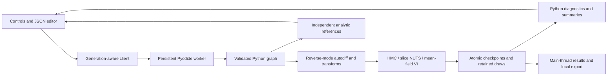

# Posterior

[Live workbench](https://dhanushkrishna4.github.io/Posterior/) · [Source](https://github.com/DhanushKrishna4/Posterior)

**See what an inference algorithm believes, inspect how it reached that result, and discover what it might have missed.**

Posterior is a small, CPU-only Python probabilistic-programming engine and a static scientific workbench. The browser executes the same package through a persistent Pyodide worker. Models, differentiation, sampling, adaptation, VI, diagnostics, and analytic references are Python; JavaScript draws the plots and manages controls. No inference service, credentials, GPU, or connection to another project is required.

This is an inspectable educational implementation, with numerical validation and deliberately difficult examples. Accepted model syntax and reassuring diagnostics do not establish that an inference result is trustworthy. It is not a replacement for established statistical software.

## Run the workbench

Node 22 or later is recommended. Runtime downloads are needed once at build time; the resulting site serves its Python runtime, NumPy, SciPy, and engine itself.

```sh
npm ci
npm run vendor
npm run build
npm run preview
```

Open **http://127.0.0.1:4173/Posterior/**. Use HTTP, not `file://`. For development, run `npm run package:engine` after Python edits, then `npm run dev`. The build always repackages Python. No external inference calls are made; imported CSV data stays on the device.

Choose a model, inspect its assumptions, run an algorithm, and compare with the independent reference. Switch algorithms or mixture initializations to compare actual runs. Centered and noncentered funnel runs compare on common model-space axes, with separate coverage, divergence and trajectory-cost summaries. Warmup is excluded from summaries. Intermediate trajectory points have different symbols from retained draws. Quick runs are explicitly preliminary.

The interface provides an advanced JSON model editor, regression CSV import with explicit columns, trace/rank/objective plots, selected-transition replay, diagnostics, local saved experiments with deletion, JSON and CSV exports, and PNG plot export. Independent VI fits have separate summaries; they are never pooled into MCMC convergence diagnostics.

The workbench uses a probability-atlas layout: five question-led experiments, a large inspectable distribution, a dedicated experiment panel, and a separate evidence section. Plot inspection supports pointer, touch, and keyboard arrows. Exact Beta reference intervals are shaded explicitly; sampled fits remain separate. See the [redesign review and before/after captures](docs/redesign/README.md).

## Native Python

Python 3.12 reproduces the pinned CI and browser dependency versions. Python 3.14 also works with compatible native NumPy/SciPy versions, recorded in the evaluation artifacts.

```sh
python3.12 -m venv .venv
.venv/bin/python -m pip install -r requirements-dev.txt
.venv/bin/python -m pip install --no-deps -e .
.venv/bin/python -m pytest -q
.venv/bin/python -m posterior_lab.cli --preset beta --algorithm nuts \
  --warmup 200 --draws 200 --chains 4 --output experiment.json --csv draws.csv
```

Use `--model examples/beta.json` for a JSON graph, `--algorithm vi --iterations 1000` for VI, or `--resume experiment.json` for a compatible interrupted checkpoint. The CLI exits with status 2 if the run stops short of completion.

```python
from posterior_lab.models import Model

model = Model("Beta update")
p = model.parameter("probability", constraint={"type": "interval", "lower": 0, "upper": 1})
model.prior("prior", "beta", p, alpha=2, beta=2)
model.observe("observations", "binomial", 7, trials=10, prob=p)
target = model.compile()
log_joint_z, gradient_z = target([0.3])
spec = model.to_dict()  # the exact representation accepted by the browser
```

See [the model language](docs/models.md), [mathematical notes](docs/mathematics.md), [samplers](docs/samplers.md), and [diagnostic definitions](docs/diagnostics.md).

## What is implemented

| Component | Scope |
| --- | --- |
| Model language | Version 1 JSON, scalar/vector continuous parameters, immutable data, named deterministic nodes/factors, derived reports, fixed shapes |
| Autodiff | Reverse-mode tapes; shared operands, accumulation, broadcasts, reductions, fixed indexing/reshape, dot/matvec, stable log-sum-exp |
| Distributions | Normal, half-normal, fixed-shape beta, Bernoulli logits, observed-count binomial, constant-covariance multivariate normal; composed finite mixtures |
| Transforms | Identity, exponential positive, scaled sigmoid interval; Jacobians included once |
| HMC | Momentum refresh, leapfrog, log-space Metropolis, momentum flip, repeated draws on rejection |
| NUTS | **Hoffman–Gelman original slice-based Algorithm 6**; recursive trees, endpoint U-turns, slice-relative continuation, bounded depth |
| Warmup | Dual averaging, bounded step-size search, expanding Welford scale windows, final frozen scales and step size |
| VI | Reparameterized mean-field Gaussian in unconstrained coordinates, analytic entropy, Adam, independent ELBO evaluation with MCSE, independently initialized fits |
| Diagnostics | Rank and folded split R-hat, their maximum, bulk/tail ESS, raw-scale mean-specific MCSE; explicit unavailable/unreliable states |
| Runtime | Sequential round-robin chains, transaction rollback, per-chain RNG/adaptation, checkpoint recovery, bounded workers/messages, local persistence |

The NUTS implementation deliberately uses neither multinomial selection nor momentum-sum stopping. Within a recursive tree, candidate probability is `n_right / (n_left + n_right)`; during top-level expansion it is `min(1, n_new / n_old)` when the subtree is valid. Adaptation uses the acceptance statistic from the final doubling subtree, as specified in Algorithm 6. Maximum-depth events are reported separately from divergences.

Diagonal preconditioning is an explicit coordinate change `z = S x`. Unit-kinetic algorithms and turning tests operate in `x`; the target is `log p_z(Sx) + sum(log S)` with gradient `S * grad_z`. `S` estimates standard deviations in unconstrained model coordinates. A scale update happens only after a completed warmup window and preserves `z`. Warmup shorter than 50 transitions uses identity scales and adapts only step size. Each chain owns its adaptation state.

## Five experiments

| Model | Independent reference and lesson |
| --- | --- |
| Beta–Binomial | Beta(2,2), 7 successes of 10 → exact Beta(9,5); stable logit Jacobian and belief updating |
| Gaussian regression | Exact coefficient posterior from linear solves; distinguish mean-response credible bands from noisy predictive bands |
| Correlated Gaussian | At correlation 0.95, marginal variances are 1 but optimal reverse-KL mean-field variances are 0.0975 |
| Six-dimensional funnel | Centered/noncentered formulations, common model-space axes, independent generative reference; no observational data |
| Separated mixture | Known weights 0.7/0.3, modes (−4,0)/(4,0); trapped chains and independently initialized VI can miss the global distribution |

Normalized references, sampled estimates, and saved comparisons are labeled separately. The funnel display is a sample-based projection onto `(y, child 0)`, not a full joint density. Two-dimensional contours are density levels, never unvalidated credible-region labels. A custom graph receives an analytic oracle only if it exactly matches the supported preset, including data.

## Interpret the evidence

- R-hat above 1.01 indicates chain disagreement. An acceptable value does not rule out unseen modes.
- High acceptance alone says little about useful exploration. Saved experiments include HMC runs with high acceptance and poor effective sample size due to path-length resonance.
- ESS is an estimate and may exceed the retained draw count for anticorrelated chains. Plot downsampling never changes diagnostics or exports.
- Mean MCSE measures uncertainty in the estimated mean due to finite simulation; posterior standard deviation describes uncertainty under the model. The MCSE uses raw-scale mean-specific ESS, not rank-based bulk ESS.
- VI minimizes a reverse-KL objective within a restricted family. A stable objective, or even recovery of the exact family optimum, does not establish posterior accuracy. No MCMC R-hat/ESS is applied to VI draws.
- Equal numbers of draws trapped in separate mixture modes do not recover unequal mixture weights. Inspect chain-specific occupancy, transitions between regions, and initialization.

## Limits and resource contract

There are at most 32 unconstrained coordinates, 256 graph nodes/factors/parameters, 1,000 observations, 10,000 elements per array, 4 chains/fits, 2,000 retained draws per chain, and NUTS depth 9. The usual examples use 1–6 coordinates. Browser VI is capped at 1,000 updates. All numerical work uses float64. Discrete latent variables, dynamic traces, parameter-dependent control flow, arbitrary model code, neural networks, distributed execution, and full-rank VI are excluded.

Default MCMC uses four chains, 200 warmup and 200 retained transitions; the longer option uses 500/1,000. Work is bounded by active wall time and gradient evaluations, not by predicted runtime or a convergence guarantee. Active wall time includes diagnostic/checkpoint work and browser yields; paused time is excluded. A budget can leave different chain lengths. Diagnostics then use the common completed prefix and label their draw count; exports preserve every completed draw.

Detailed paths are recorded for only four selected transitions per chain, at most 256 points and 128 branch records per selected transition. Omitted records are counted. Compact transition records preserve outcomes and costs for every completed transition. Retained draws are never thinned or silently discarded.

## Checkpoints and cancellation

The Python runtime is authoritative. A proposal uses copied random-generator and adaptation state; position, RNG, metadata, adaptation, and any retained draw commit only after completion. An exhausted budget abandons the entire pending transition.

The worker yields between completed transitions. Pause/cancel messages therefore take effect at those boundaries. A stalled transition can be terminated with **Recover worker**, recreating Python from the last checkpoint received by the main thread; an unfinished transition is discarded. No SharedArrayBuffer or isolation headers are required. Generation IDs reject responses from superseded runs, and changing model/data/settings creates a new run identity.

Versioned JSON checkpoints contain the model/hash, exact settings and initial positions, PCG64 states, positions/gradients, dual averaging and Welford accumulators, scales, counters, retained draws, diagnostics, timings, and runtime versions. Imports are data-only and validated before restoration. Same-runtime resume is tested for exact draws and RNG state; different NumPy/Pyodide builds promise tested numerical tolerances, not identical full chains. Prediction and VI evaluation use independent random streams.

## Verification and measured behavior

See [the evaluation report](reports/README.md), [native end-to-end results](reports/native-evaluation.json), [quality-gated sampler validation](reports/sampler-validation.json), [independent inference reference](reports/reference-inference.json), and [browser checks](reports/browser/report.json). Each contains actual settings, seeds, environment, work counts, and results; failed examples are preserved. Raw native checkpoints are in `reports/raw/`, and raw independent-reference draws are in `reports/reference-inference-draws.npz`.

The available machine was verified as **Apple M3 with 8 GiB RAM**. Four-chain Beta NUTS (200 warmup + 200 retained draws per chain) took about **1.99 seconds natively**; the browser default completed in about **16 seconds**, including UI work. Exact settings and build differences are recorded, so these are not a pure language-overhead comparison. The native evaluation process peaked near **145 MiB RSS**; browser memory was not measured. Native Python and browser WebAssembly timings are reported separately. Short browser execution tests establish integration, not distributional quality. The native fixed-seed statistical tests and exact oracles provide the latter evidence within their stated tolerances.

```sh
.venv/bin/python scripts/evaluate.py --pilot
.venv/bin/python scripts/validate_samplers.py
.venv/bin/python scripts/reference_inference.py
.venv/bin/python scripts/evaluate.py
npm run build
npm run test:browser
npm run test:redesign
.venv/bin/python scripts/verify_build.py
```

`reference_inference.py` intentionally exits with status 1 when its preserved eight-step HMC resonance case fails the declared quality gate. Its seven-step followup and the other comparisons are recorded separately; the script does not erase the failed run.

The build itself runs no research benchmark. Browser checks launch the production build over HTTP under the case-sensitive `/Posterior/` subpath. Install Chromium with `npx playwright install chromium` if needed; `PLAYWRIGHT_EXECUTABLE` can select an existing binary.

## Static deployment

The complete deployable artifact is `dist/`. Pyodide 0.27.7, NumPy 2.0.2, SciPy 1.14.1, and OpenBLAS assets are self-hosted and hash-checked against `scripts/runtime-lock.json`. The selected runtime assets total about 34.8 MiB; no complete scientific distribution or native reference package is shipped. The Python source ZIP has sorted entries, stable timestamps, and stable permissions.

The public [Pages workbench](https://dhanushkrishna4.github.io/Posterior/) is deployed and verified. GitHub Actions passed 178 Python tests and 18 browser checks; the hosted site separately passed all 18 browser checks. See [deployment evidence](reports/deployment.json) and [hosted results](reports/hosted/report.json).

The GitHub Actions workflow checks Python, builds, tests the production browser, and prepares a Pages artifact. Publishing is an **explicit manual workflow dispatch** with `deploy: true` after configuring Pages to use GitHub Actions. Push/PR checks do not publish. Repository name/path changes require updating `base` in `vite.config.js` and rerunning subpath checks.

## Architecture



Research attribution: [Neal, HMC](https://arxiv.org/abs/1206.1901); [Hoffman & Gelman, NUTS](https://www.jmlr.org/papers/volume15/hoffman14a/hoffman14a.pdf); [Kucukelbir et al., ADVI](https://jmlr.org/papers/v18/16-107.html); [Vehtari et al., diagnostics](https://arxiv.org/abs/1903.08008); [Stan transforms](https://mc-stan.org/docs/reference-manual/transforms.html), [warmup structure](https://mc-stan.org/docs/reference-manual/mcmc.html), [funnel/reparameterization](https://mc-stan.org/docs/stan-users-guide/efficiency-tuning.html), and [diagnostic guidance](https://mc-stan.org/learn-stan/diagnostics-warnings.html); [posterior R-hat](https://mc-stan.org/posterior/reference/rhat.html); [Pyodide workers](https://pyodide.org/en/stable/usage/webworker.html). The warmup structure is inspired by Stan; implementation equivalence is not claimed.
