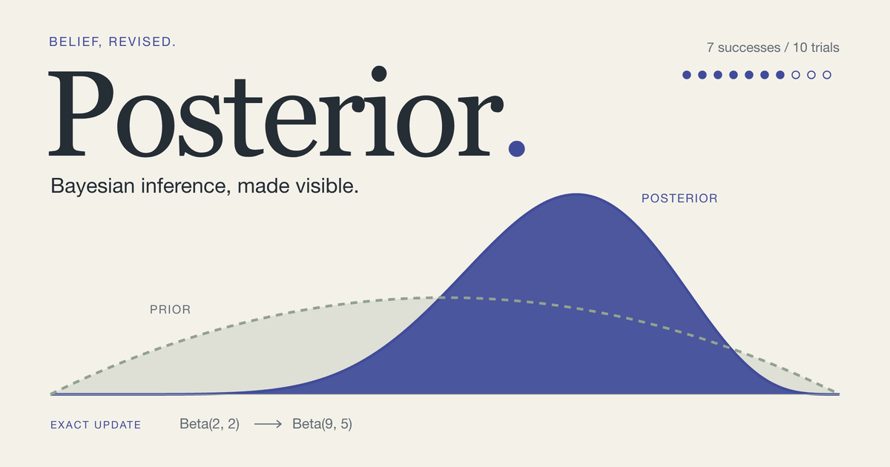
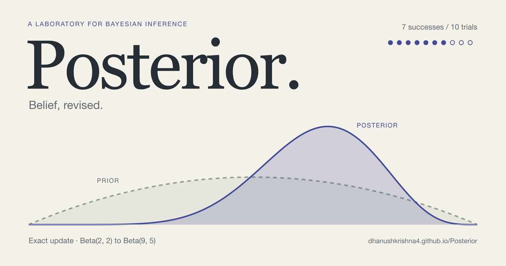
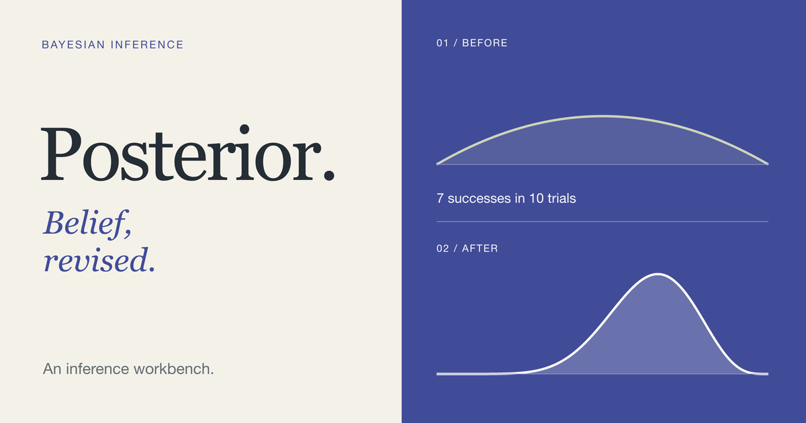

# Posterior: an exact update, made visible



The card carries the current workbench's warm paper, ink, indigo and sage palette, large Georgia wordmark, and inspectable probability figures into a compact poster. The prior is broad and quiet; the posterior becomes a strong indigo silhouette. Seven filled circles and three open circles encode the observations. The card depicts an **exact analytic update**, not simulated draws or a convergence claim.

## Files and regeneration

- Published image: [`public/posterior-og-v1.png`](../../public/posterior-og-v1.png), **1200 × 630**, opaque 8-bit truecolor RGB PNG, explicitly tagged sRGB, under 1 MB. Exact bytes and SHA-256: [`proofs/export.json`](proofs/export.json).
- Editable composition, copy, typography and geometry: [`compose.py`](compose.py).
- Portable editable vector export: [`card.svg`](card.svg). Lettering is outlined; edit text in `compose.py` and regenerate.
- Rasterization: [`export.mjs`](export.mjs); color conversion, optimization and proofs: [`finish.py`](finish.py).

From the repository root, regenerate the final PNG, SVG, studies and sharing-size proofs with:

```sh
npm run og:render
```

Initial setup, if these existing tools are not installed:

```sh
npm ci
python3 -m venv .venv
.venv/bin/python -m pip install -r tools/og/requirements.txt
npx playwright install chromium
```

The verified local render uses macOS's licensed Georgia Regular, Georgia Italic and Helvetica Neue Regular. Georgia is the site's display family; Helvetica Neue is the macOS sans-serif family used for the card's supporting text. Font binaries are neither copied into this repository nor sent to visitors. Raster and outlined-vector artwork contains the rendered design, not installable fonts. There are no stock images or third-party illustrations.

On another machine, provide legally installed copies of the same fonts through `POSTERIOR_SERIF_FONT`, `POSTERIOR_ITALIC_FONT` and `POSTERIOR_SANS_FONT`. A missing font or glyph is an error, never a silent substitution. [`fonts.json`](fonts.json) records font file hashes. `PYTHON` can select another Python environment. The renderer prefers the repository's installed Playwright Chromium; it can reuse a complete local Playwright installation if needed. `PLAYWRIGHT_EXECUTABLE` explicitly selects a browser. The exact verified browser version is in [`proofs/renderer.json`](proofs/renderer.json); use the same font files, versions in `requirements.txt`, browser version and source for byte-identical regeneration.

Every glyph is resolved to paths before Chromium receives the SVG. External requests are blocked, there are no animations or random inputs, and the renderer waits for font readiness. CPU rasterization (`--disable-gpu`) avoids the small edge differences observed with GPU rendering. It rasterizes at 2×, then downsamples once with Lanczos, converts to RGB and adds the sRGB chunk. Two consecutive CPU exports in the verified environment produced the same PNG SHA-256. Nothing is generated in the visitor's browser.

## Scientific source

The default workbench model in `web/main.js` and `posterior_lab/examples.py` uses a Beta(2,2) prior and 7 successes in 10 binomial trials. Conjugacy gives Beta(9,5). The plotted curves are:

```text
prior(x)     = 6 x (1 − x)
posterior(x) = 6435 x⁸ (1 − x)⁴
0 ≤ x ≤ 1
```

Both curves use the same horizontal domain and density scale. They are sampled at 1,001 deterministic points; no independent peak normalization, stochastic smoothing, or invented measurements are used. Formula values were checked against the repository's SciPy reference. Shading distinguishes the distributions and does not mark a credible interval.

## Studies and refinement

The current portfolio's live metadata was checked and its actual [`card-v2.png`](https://dhanushkrishna4.github.io/card-v2.png) was opened and visually inspected. Relevant public repository files were also inspected: `index.html` and `public/card-v2.png`, at revision `d9b70c3364c5c7399bedf3e86c46f43d027a8887`. The benchmark informed scale, clarity and finish only. Its signature, dark/red palette, typography pairing and background contours were not used.

Two materially different arrangements were rendered:

| Single probability landscape | Two sequential evidence plates |
| --- | --- |
|  |  |

The landscape won because one shared field makes the change in belief immediately legible and gives the name greater scale. The two-plate study is orderly but splits the visual comparison and reads more like instructional panels.

The [first export](proofs/first-export.png) was too pale at thumbnail size, and its URL and long eyebrow added small-text noise. The refinement increased the density height and indigo fill, redrew the prior line above the posterior so both remain visible, made the period indigo, replaced supporting copy with a clear descriptor, and removed the URL. The final result was inspected at full size, [600 × 315](proofs/600x315.png) and [300 × 158](proofs/300x158.png).

The [edge trim](proofs/edge-trim.png) and [16:9 crop](proofs/16x9.png) retain the name, descriptor and curve silhouette. The deliberately harsh [square stress crop](proofs/square-stress.png) cuts the wordmark. This is a wide large-image card, not a universal crop-safe composition; the layout was not weakened to accommodate an arbitrary square crop. Tiny formula annotations reward a full-size view; the name and main scientific idea carry the thumbnail.

## Metadata and delivery

All Open Graph and Twitter tags are in the initial [`index.html`](../../index.html) head, including canonical URL, title, description, image type, dimensions and descriptive alt text. The image uses the absolute HTTPS URL:

<https://dhanushkrishna4.github.io/Posterior/posterior-og-v1.png>

The metadata follows the [Open Graph protocol](https://ogp.me/). Vite copies `public/posterior-og-v1.png` unchanged to `dist/posterior-og-v1.png`; the browser runtime is not needed to serve it.

```sh
npm run vendor  # Once on a fresh clone: obtain the pinned workbench runtime.
npm run build
npm run test:og
npm run preview -- --port 4173 --strictPort
# In another terminal:
npm run test:og -- --url http://127.0.0.1:4173/Posterior/
# After the authorized release:
npm run test:og -- --url https://dhanushkrishna4.github.io/Posterior/
```

`test:og` checks tag uniqueness and content, canonical HTTPS address and case-sensitive Pages subpath, PNG signature, dimensions, 8-bit RGB color type, lack of transparency, sRGB tag, file-size limit, and equality between source and production images. The URL mode also checks HTTP 200, HTML and image MIME types, static served metadata and image hash equality. CI runs the local artifact check immediately after the production build.

Website sharing metadata does **not** configure GitHub's repository social-preview setting. To use this card when sharing the GitHub repository URL, upload the same PNG in the repository's Settings → General → Social preview. No repository social-preview upload or third-party cache refresh is claimed by this task.
